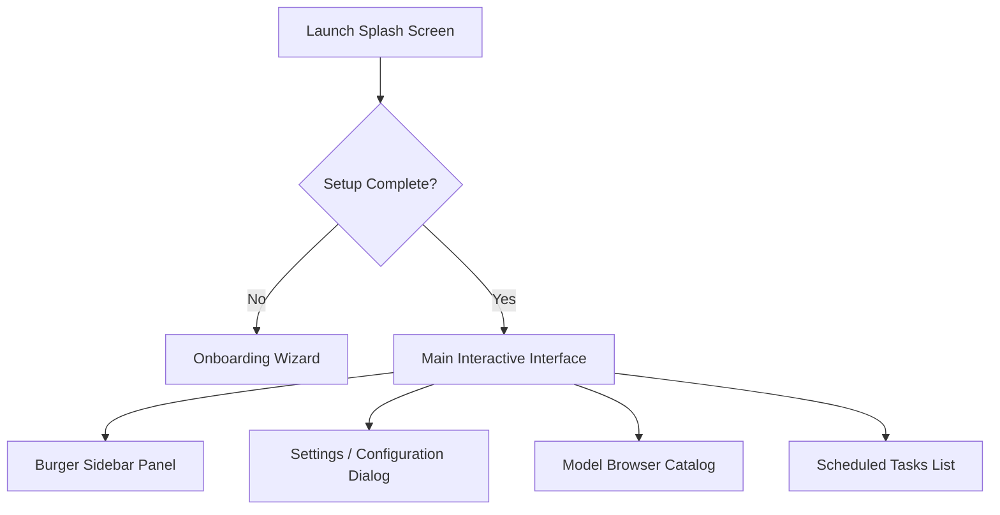

# Antflow — System Architecture & Context Reference

Antflow is a cross-platform, local-first automation agent designed to run seamlessly on Windows, macOS, Linux, and mobile devices (Android & iOS). It can run in either **TUI (Terminal User Interface)** or **GUI (Graphical User Interface)** mode and is fully portable (e.g., executable from a USB drive without footprint).

---

## 1. Core Technology Stack

| Layer | Technology / Libraries | Purpose |
| :--- | :--- | :--- |
| **Backend & Core** | Rust (v2021) | Main runtime, OS hooks, and database access |
| **Database** | SQLite ([db.rs](file:///c:/Users/Jeison/Documents/Content/Programs/Rust/antflow/antflow-client/src/db.rs)) via `rusqlite` | Sessions history, scheduled tasks, undo log |
| **Configuration** | TOML ([config.rs](file:///c:/Users/Jeison/Documents/Content/Programs/Rust/antflow/antflow-client/src/config.rs)) | Configuration settings (`config.toml`) |
| **GUI Framework** | Tauri v2 ([gui.rs](file:///c:/Users/Jeison/Documents/Content/Programs/Rust/antflow/antflow-client/src/gui.rs)) | Custom window, drag region, OS hooks, front-backend bridge |
| **TUI Framework** | `ratatui` + `crossterm` ([ui.rs](file:///c:/Users/Jeison/Documents/Content/Programs/Rust/antflow/antflow-client/src/tui/ui.rs)) | Rich, interactive terminal UI layout |
| **Local AI (Embedded)** | `candle-core`, `candle-transformers`, `tokenizers` | In-process inference for embeddings and lightweight models |
| **Local AI (External)** | Ollama & LocalAI ([localai.rs](file:///c:/Users/Jeison/Documents/Content/Programs/Rust/antflow/antflow-client/src/ai/localai.rs)) | Native WSL/host background execution of chat, image, audio, and video models |
| **Automation Engine** | `enigo`, `arboard`, `screenshots`, `rusty-tesseract` | Mouse clicks, keyboard typing, clipboard hooks, screenshot captures, and OCR |
| **Voice Processing** | Web Speech API (WebView) / Whisper | Native Speech-to-Text (STT) and Text-to-Speech (TTS) |

---

## 2. Project Folder Structure & File Schema

```
antflow/
├── antflow-client/             # Main client application workspace
│   ├── build.rs                # Tauri build integration hook
│   ├── Cargo.toml              # Rust crate metadata & dependencies
│   ├── obfuscate.js            # Obfuscates production frontend code
│   ├── tauri.conf.json         # Tauri app window & permissions configuration
│   ├── src/                    # Backend source code (Rust)
│   │   ├── main.rs             # Client entrypoint: CLI commands router
│   │   ├── lib.rs              # App orchestrator (runs TUI or GUI mode)
│   │   ├── config.rs           # TOML config parser & path resolver
│   │   ├── db.rs               # SQLite client: history, tasks, undo logs
│   │   ├── gui.rs              # Tauri handler register & window controller
│   │   ├── tools.rs            # Automation tools (keyboard/mouse simulation)
│   │   ├── executor.rs         # Prompt executor & multi-turn execution loop
│   │   ├── screenshot.rs       # Platform-specific screen capture module
│   │   ├── redact.rs           # Tesseract OCR & Sensitive regex-based scrubber
│   │   ├── scheduler.rs        # Cron job daemon & task scheduler
│   │   ├── device.rs           # OS, CPU, RAM metrics gatherer
│   │   ├── voice.rs            # Text-To-Speech (TTS) & audio transcriber
│   │   ├── ai/                 # AI integrations module
│   │   │   ├── mod.rs          # Provider dispatcher & factory logic
│   │   │   ├── localai.rs      # LocalAI engine driver (WSL & catalog)
│   │   │   ├── ollama.rs       # Ollama API driver & model downloader
│   │   │   └── generic/openai.rs # Cloud provider APIs handlers
│   │   └── tui/                # Terminal user interface module
│   │       ├── app.rs          # TUI state holder & keystroke handler
│   │       ├── ui.rs           # Ratatui widgets renderer (modals, chats)
│   │       └── runner.rs       # TUI terminal setup & rendering loop
│   └── src-tauri/
│       └── frontend/           # Web frontend source code (HTML/CSS/JS)
│           ├── index.html      # Main GUI structure & overlay panels markup
│           ├── index.css       # Glassmorphism, animations, & layouts stylesheets
│           └── index.js        # IPC listeners, audio recordings, state logic
└── APP_DESCRIPTION.md          # Project description context file (This file)
```

---

## 3. Key Architecture & Design Decisions

### A. TUI vs. GUI Launch Auto-Detection
The entrypoint ([lib.rs](file:///c:/Users/Jeison/Documents/Content/Programs/Rust/antflow/antflow-client/src/lib.rs)) checks the shell environment:
- If run inside a terminal context (or initiated with `--tui` / `cli`), the app launches the **Ratatui TUI mode**.
- Otherwise, it spawns the **Tauri GUI** containing a custom borderless window.

### B. Storage & Portability Mode
- **Portable (Default):** All databases (`antflow.db`), logs, configuration TOMLs, and downloaded models are stored in the *same folder as the executable binary*. This makes the app run perfectly off USBs.
- **Global:** Configs and models are kept in the platform's standard configuration path (e.g., `%APPDATA%\antflow` on Windows).

### C. LLM Redaction & Safety Heuristics
Before taking a screenshot to analyze screen status ([redact.rs](file:///c:/Users/Jeison/Documents/Content/Programs/Rust/antflow/antflow-client/src/redact.rs)), the system performs **Tesseract OCR** on the captured frame. 
- Regular expression patterns automatically look for sensitive identifiers (emails, API keys, passwords, bank cards).
- It draws black bounding boxes over matching text coordinates before feeding the image context to the active LLM.

### D. Multi-Functional Model Execution
- Grouped into 6 categories: **Chat & Reasoning**, **Images**, **Videos**, **Speaking (TTS)**, **Listening (STT)**, and **Music**.
- Local execution is optimized so that a multi-functional model (e.g., serving both chat and speech tasks) only spins up a single background thread/process instance.

---

## 4. Automation Tools Schema

The agent operates via a collection of tool functions exposed in [tools.rs](file:///c:/Users/Jeison/Documents/Content/Programs/Rust/antflow/antflow-client/src/tools.rs):
- `mouse_move(x, y)`: Move cursor to coordinates.
- `mouse_click(button)`: Click (left/right/middle).
- `mouse_double_click()` / `mouse_drag(from_x, from_y, to_x, to_y)` / `mouse_scroll(dx, dy)`.
- `key_press(key_code)`: Press specific hardware key (like Enter, Backspace, Alt, Win).
- `type_text(text)`: Simulate typing text values.
- `clipboard_set(text)` / `clipboard_get()`: Manage Clipboard values.
- `open_url(url)`: Open standard system browser pages.
- `run_command(command)`: Execute standard terminal command line instructions.
- `run_script(script_code)`: Save and execute temporary scripts (Python, PowerShell, Bash).
- `read_file(path, start_line, end_line)`: Read files or target lines.
- `str_replace(path, find, replace)`: Safe search-and-replace modification of local files (asserts uniqueness).

---

## 5. UI/UX Interface Guide

### GUI Client Layout & Screens

The GUI utilizes a futuristic glassmorphic UI styled with Vanilla CSS ([index.css](file:///c:/Users/Jeison/Documents/Content/Programs/Rust/antflow/antflow-client/src-tauri/frontend/index.css)) and structured in [index.html](file:///c:/Users/Jeison/Documents/Content/Programs/Rust/antflow/antflow-client/src-tauri/frontend/index.html) and [index.js](file:///c:/Users/Jeison/Documents/Content/Programs/Rust/antflow/antflow-client/src-tauri/frontend/index.js).



#### 1. Onboarding Wizard Screen (`#onboarding`)
Spawns as a fullscreen modal for unconfigured builds.
- **Card 1 (Welcome):** Introductory welcome greeting, platform detection details.
- **Card 2 (Storage Selector):** Toggles between *Portable Mode* (self-contained) and *Global Mode*.
- **Card 3 (Provider Setup):** Dropdown list of providers (Ollama, OpenAI, Anthropic, Gemini, LocalAI). Sets keys.
- **Card 4 (Session Memory):** Configures if the app remembers history and sets the maximum tokens/history context.
- **Card 5 (Complete):** Success checklist, finishes setup.

#### 2. Main Interface (Compact View vs Maximized View)
- **Compact View:** Minimal borderless card matching Tauri configuration parameters (700x130). Stays always on top. Displays the active session ID, model status chip, input bar, and wake word voice icon.
- **Maximized View:** Extends to a complete workspace console. Spawns title bar control buttons (Minimize, Maximize/Restore, Close). Shows the full chat feed.
- **Thinking Wave UX (Cursor style):** When the agent is reasoning or running terminal commands, the chat bubbles animate a horizontal text-color wave. Styled using a linear background gradient shifting through `@keyframes textShimmer` with a background-clip property:
  ```css
  background: linear-gradient(90deg, var(--text-dim) 0%, var(--accent) 50%, var(--text-dim) 100%);
  background-size: 200% auto;
  -webkit-background-clip: text;
  -webkit-text-fill-color: transparent;
  animation: textShimmer 2s linear infinite;
  ```

#### 3. Sidebar Panel (`#max-sidebar`)
Slides in from the left when toggled. Contains:
- **Conversation List:** Clickable past chat sessions with a live search filter.
- **System Stats Grid:** Hardware monitor showing current memory load, platform, OS name, scale factor, and CPU cores.
- **Navigation Footer:** Dedicated buttons to overlay screens for scheduled tasks and settings.

#### 4. Model Catalog overlay (`#overlay-model`)
- Grouped into capability filters (**Chat & Reasoning**, **Images**, **Videos**, **Sound**).
- Includes progress bars for downloading models (via Ollama or LocalAI), options to cancel active transfers, and options to import custom `.gguf` files.

#### 5. Scheduler Panel (`#overlay-tasks`)
- Displays all cron-style background automation tasks.
- Supports pause, resume, and deletion commands.

#### 6. Settings Panel (`#overlay-settings`)
- Configures parallel execution limit (`num_parallel`).
- Changes storage folders and toggles background processes (enable/disable scheduler daemon, keep running on window close).

---

## 6. TUI Client Layout & Screens

The Ratatui Terminal TUI mimics the GUI structures with keyboard-navigable widgets:
1. **Top Status Bar:** Shows active model, connectivity status, memory/CPU details.
2. **Interactive Command Console:** Bottom command input with active spinner states.
3. **Floating Overlays:** Rendered using styled borders (`Block`) and clear overlay grids for selecting models, reviewing API keys, managing cron tasks, and responding to agent clarification questions.
